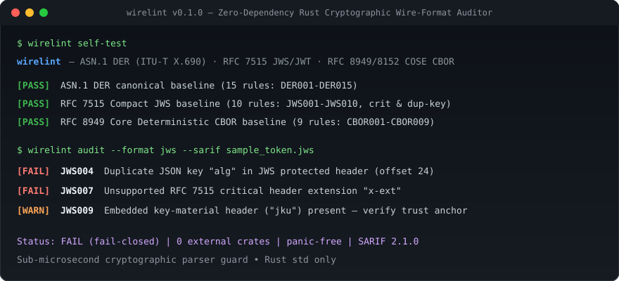

# wirelint

**Zero-dependency, fail-closed Rust structural auditor for cryptographic wire formats (ASN.1 DER, RFC 7515 JWS/JWT, and RFC 8949/8152 COSE CBOR).**



Cryptographic parser differentials—where one verifier accepts a non-canonical encoding, duplicate header key, or trailing garbage that another rejects—are a recurring root cause of signature-malleability, authentication, and bypass bugs. `wirelint` is a standalone, panic-free, zero-crate Rust library and CLI that audits raw wire artifacts against strict RFC canonicalization rules and emits text, JSON, or **SARIF 2.1.0** diagnostics.

```
raw bytes / token
   │
   ├──► der::audit_der()   ──► ITU-T X.690 / RFC 5280 strict DER canonicalization
   ├──► jws::audit_jws()   ──► RFC 7515 Compact JWS + §4.1.11 crit + dup-key guard
   └──► cbor::audit_cbor() ──► RFC 8949 §4.2 Core Deterministic CBOR / COSE maps
                │
                ▼
     AuditReport { PASS | FAIL, rule_id, byte_offset } ──► Text | JSON | SARIF 2.1.0
```

## Rule Coverage

| Format | Rule IDs | Security & Canonicalization Invariants Enforced |
| :--- | :--- | :--- |
| **ASN.1 DER** | `DER001`–`DER015` | Rejects indefinite length (`0x80`), non-minimal long-form lengths, leading-zero lengths, constructed primitive tags, non-canonical `BOOLEAN` (`!= 0x00/0xFF`), non-minimal `INTEGER` sign octets, non-zero `BIT STRING` padding bits, non-minimal OID subidentifiers, invalid UTF-8, depth `> 32`, truncation/OOM lengths, and trailing bytes |
| **RFC 7515 JWS** | `JWS001`–`JWS010` | Enforces 3-part compact serialization, canonical unpadded Base64URL (rejects `=` and non-zero trailing bits), strict JSON parser rejecting **duplicate object keys**, rejects `alg: none` & empty signatures, enforces **RFC 7515 §4.1.11 `crit`** against caller's allowlist, and warns on embedded key headers (`jwk`, `jku`, `x5u`) |
| **RFC 8949/8152 CBOR** | `CBOR001`–`CBOR009` | Rejects indefinite-length items (`ai=31`), non-minimal integer/length encodings, invalid UTF-8 text strings, **duplicate map keys**, non-canonical bytewise map key ordering (§4.2.1), depth `> 32`, truncation/OOM counts, and trailing bytes |

## Quick Start

```bash
# Build & run the full adversarial & unit RFC compliance test suite (zero external crates)
cargo test

# Run built-in baseline verification & sub-microsecond throughput benchmark
cargo run --release -- self-test

# Audit a DER certificate/CRL, JWS token, or COSE CBOR artifact
cargo run --release -- audit --format der  path/to/artifact.der
cargo run --release -- audit --format jws  --crit x-tenant path/to/token.jws --sarif
cargo run --release -- audit --format cbor path/to/cose.cbor --json
```

## GitHub Actions Integration (Drop-In Action)

```yaml
- name: Audit cryptographic wire artifact
  uses: PRAVIN-952006/wirelint@v0.1.0
  with:
    format: jws
    path: path/to/token.jws
    sarif-file: wirelint.sarif

- name: Upload SARIF to GitHub Security
  if: always()
  uses: github/codeql-action/upload-sarif@v3
  with:
    sarif_file: wirelint.sarif
```

## Design Principles

* **Zero external dependencies:** Compiles offline with only the Rust standard library (`[dependencies]` is empty), eliminating transitive supply-chain risk.
* **Bounds-checked & panic-free:** Every length and collection count is validated against remaining buffer capacity before iteration; recursion is strictly capped at `MAX_NESTING_DEPTH = 32`.
* **CI-ready SARIF 2.1.0:** Native SARIF output integrates directly with GitHub Code Scanning without external JSON/SARIF crates.

## License

MIT — see [LICENSE](LICENSE). Security reports: see [SECURITY.md](SECURITY.md).
